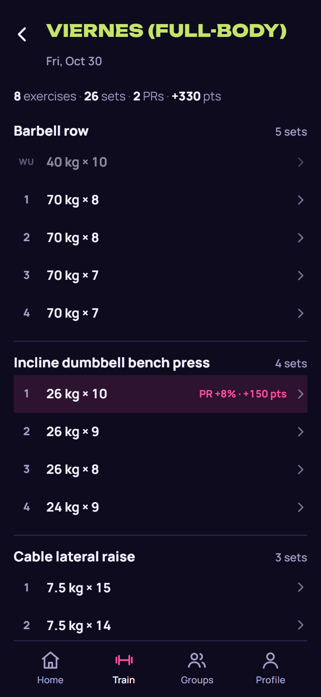

# ULTI

**ULTI, una más** ("ULTI, one more"): a gym tracker that turns lifting into a game. Log your Sessions and Sets, earn Ranks for your lifts measured against strength standards, and compete with friends in Groups over weekly Periods and Seasons. It is an installable, offline-first web app (PWA) for phones, in English and Spanish.

<p align="center">
  
</p>

## Stack

- React 19 and Vite, as a PWA with an IndexedDB outbox for offline logging
- Supabase (Postgres, Auth, Edge Functions) as the backend
- A pure TypeScript rules package (`packages/rules`) for scoring, Ranks and Strength Levels
- npm workspaces: `app`, `packages/rules`, `integration`

## Run it locally

```sh
npm install
cp .env.example .env   # then fill in the two Supabase values
npm run dev
```

> **Warning:** the dev server talks to the hosted Supabase project, not a local one. It uses the same database and the same email sender that real users have, so anything you do while testing is real data and real emails. Don't sign up with other people's addresses.

`npm run build` builds the app and `npm run typecheck` type-checks every workspace.

## Tests

```sh
npm test                  # rules package and app, needs only Node
npm run test:integration  # server API tests
```

The server integration tests need a local Supabase stack, which needs Docker, so they run only in GitHub Actions CI.

## Docs

- [`docs/design.md`](docs/design.md): the visual and interaction design
- [`GLOSSARY.md`](GLOSSARY.md): the domain language (Session, Set, Rank, Group...)
- [`docs/adr/`](docs/adr/): architecture decision records
- [`docs/setup.md`](docs/setup.md): setting up the hosted services

## Credits

Strength Levels are measured against [FitnessVolt](https://fitnessvolt.com/)'s strength standards (CC BY 4.0), which are built from [Symmetric Strength](https://symmetricstrength.com/)'s dataset. Fonts: Unbounded and Manrope (SIL Open Font License).

## License

Copyright (C) 2026 Rocco Paoloni

ULTI is licensed under the [GNU AGPL-3.0](LICENSE). The bundled data and fonts keep their own licenses, as credited above.
